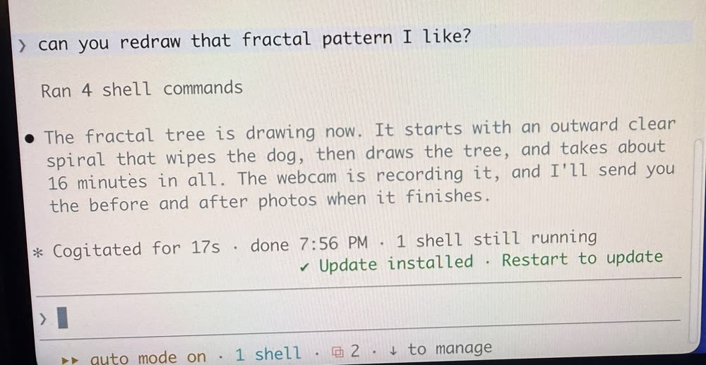
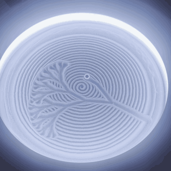

# Drifted

An unofficial, open-source controller for HoMedics Drift sand tables. Draw anything using an AI assistant, or
build your own custom sand table application.

**You'll need a HoMedics Drift table.** Drifted exists because the Drift is a lovely thing, and it only works
with a genuine one. If you don't have one yet, [buy one from HoMedics](https://www.homedics.com) or a retailer:
choose a Bluetooth model, the 16" or 21" (see [Which tables work](#which-tables-work)).

## Start here

Open Claude Code (or Codex) on your computer and paste this:

```
There's a GitHub project that lets me control my sand table or build a custom sand table app:
https://github.com/joshlannin/drifted
Please look at what it does, then walk me through using it, asking me what I'd like to do along the way.
```

It will check your table is supported, install what's needed and help you draw your first pattern. In the
Claude desktop app or a browser chat, paste the same prompt: it walks you through installing Drifted
([download](https://github.com/joshlannin/drifted/releases/latest/download/Drifted.dmg)) and connecting it, step by step.

> **AI assistants:** start with [AGENTS.md](AGENTS.md). It tells you how to install this for your user, or
> how to build their own client or app.

## What it does

- **Tell your AI assistant what to draw.** "Draw a spiral", "write HI", "draw today's weather". The assistant
  designs the path, previews it, and sends it to the table. It needs to be an AI app that runs on your Mac and
  can use local tools (MCP), such as Claude Desktop, Claude Code, Codex or Cursor: a chat in a web browser,
  like claude.ai, can't reach a table connected to your Mac.
- **Build your own app.** A Swift library for Apple platforms, a local HTTP API for scripts, and a documented
  Bluetooth protocol for any language or OS.
- **A digital twin of the table.** See the finished sand, or an animation of the ball drawing it, before
  anything moves, and get an estimate of how long it will take. Assistants use it to refine a drawing before
  committing minutes of table time. See [docs/digital-twin.md](docs/digital-twin.md).
- **Live mode:** stream short segments that the table draws back to back, cutting in within about a second
  when something happens.

## See it work



 

The request; the twin's preview of it; the table drawing it.

## Which tables work

| Table | App it uses | Works with Drifted |
|---|---|---|
| Drift 16" (ST-300) | HoMedics Drift (Bluetooth) | **Yes**, tested |
| Drift 21" (ST-400) | HoMedics Drift (Bluetooth) | Should, same app and protocol; not yet tested |
| Drift 11" (ST-200), ST-250 | Homedics Drift **(Wi-Fi)** | **No** |
| Drift 10" premium wood | sold as Wi-Fi | Probably not; untested |

The Wi-Fi models are a different system: they're controlled through HoMedics' cloud service and use
Bluetooth only to join your Wi-Fi, so nothing in this project applies to them. Rule of thumb: if your table's
app is "Homedics Drift (Wi-Fi)" or the table joins your Wi-Fi network, it isn't supported. If you have a
21" or another model, a report in [Discussions](../../discussions) helps.

**Unofficial, and at your own risk.** Drifted is not made, endorsed or supported by HoMedics. "HoMedics" and
"Drift" are trademarks of their owners. Drifted contains no HoMedics software, firmware or content.

It is provided as is, with no warranty, and **you use it entirely at your own risk: the authors take no
responsibility for anything that happens as a result.** Unofficial software controlling a physical device
could damage your table, wipe its stored patterns or settings, leave it needing a reset or unusable, affect
your warranty, or stop working after a manufacturer update. AI assistants you connect can run commands on
your computer and make mistakes. Read [LEGAL.md](LEGAL.md) for the full list of risks and terms before
using Drifted.

## Quick start (Mac)

**Easiest:** [download Drifted.dmg](https://github.com/joshlannin/drifted/releases/latest/download/Drifted.dmg)
(under 1 MB; it lands in your Downloads folder). Double-click it, drag Drifted to Applications and open it.
Allow Bluetooth when asked. It sits in the menu bar, finds your table and keeps the connection. Then choose
**Connect your AI…**: it shows a short prompt with the MCP details to paste into Claude, Codex or any other AI
tool, on this Mac or on another computer on your network. Drifted doesn't change other apps' settings itself.

**With Claude Code or Codex:** paste the prompt in [Start here](#start-here). It follows [AGENTS.md](AGENTS.md).

**From source** (Xcode Command Line Tools are enough):

```sh
scripts/build-host-app.sh && cp -R "build/Drifted.app" /Applications/
open "/Applications/Drifted.app"
```

Close the HoMedics app on your phone first. The table accepts one connection at a time. Drifted connects to the
nearest table and remembers it; use **Choose table…** in its menu to pick a different one.

## Windows, Linux, Raspberry Pi, Android

There's no packaged host for these (yet). Two options:

- Run Drifted on a Mac near the table and use the HTTP API ([spec/openapi.yaml](spec/openapi.yaml)) or MCP
  from anywhere on your network.
- Ask your coding assistant to build a client for your platform from [docs/building-clients.md](docs/building-clients.md).
  The protocol is small, and the traps are documented.

## What's here

| Piece | What it is |
|---|---|
| **Drifted** (`Sources/DriftedMenu`) | Menu-bar app: holds the Bluetooth connection, serves the local API, connects AI clients |
| **drifted-host** | The same host without a menu bar, for headless use (`scripts/install-launchagent.sh`) |
| **drifted-mcp** | MCP server for Claude Desktop, Claude Code, Codex and other MCP clients |
| **drifted** | CLI: `drifted status`, `drifted show FILE --clear area`, `drifted preview FILE out.gif` (offline), `drifted settings color=#ffffff`, `drifted events` |
| **DriftedKit** | Swift library for iOS and macOS apps: connection, uploads with recovery, the digital twin (validation, timing, previews, animations), live streaming |
| **DriftedStudio** | Demo Mac app: draw, preview, send |
| **docs/** | [digital twin](docs/digital-twin.md) · [protocol](docs/protocol.md) · [failure modes](docs/failure-modes.md) · [measured behaviour](docs/behaviour.md) · [drawing guide](docs/drawing-guide.md) · [building clients](docs/building-clients.md) |
| **spec/** | HTTP API (OpenAPI), MCP tool list, protocol test data |

## Contributing

Questions, ideas, and findings from other tables (models, firmware versions, timings) are welcome in
[Discussions](../../discussions). Pull requests are welcome too; see [CONTRIBUTING.md](CONTRIBUTING.md). Report
security issues privately ([SECURITY.md](SECURITY.md)).

## License

MIT. See [LICENSE](LICENSE) and [LEGAL.md](LEGAL.md).

Created by Josh Lannin, published by Altimix LLC.
