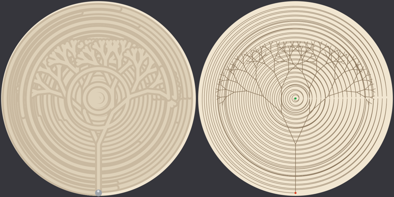
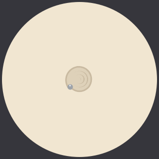

# Digital twin

Drifted includes a model of the table that runs without one. Use it to check and refine a drawing before the
ball moves, and to show people what's coming: a picture of the finished sand, or an animation of the ball
drawing it. A drawing takes minutes to tens of minutes and can't be undone, so this is where design
iteration should happen.

Left: the sand as it should look afterwards. Right: the route, green at the start and red at the end. The
fine branches that read clearly as thin lines merge into solid shapes in the sand, as they do on the table.

## What it models

- **Geometry.** The table is the unit disc: `xy` in table radii, centre (0, 0), +x right, +y up; or polar
  `[theta, rho]`.
- **Motion.** Between consecutive points the table turns and extends together, so a long step traces an arc,
  not a straight chord. Before a drawing starts, the ball makes one such move from wherever it is to the first
  point, and that move is drawn too.
- **Time.** The ball moves at a roughly constant speed along its path, about 0.115 table radii per second at
  the default speed setting, so time follows path length.
- **The groove.** The ball is about 0.07 table radii across and leaves a groove that wide. Lines closer
  together than that merge, and later grooves cut through earlier ones.
- **Safety checks.** The validator keeps every point inside the disc, splits steps the table would take the
  long way round, and reports what it fixed. Previews and timings use the checked drawing, exactly what would
  be sent.
- **Clearing.** With `clear: "area"` or `"full"`, the sweep is part of the preview, the animation and the time.

## What it doesn't model

- **Sand physics beyond the groove:** ridges, depth, and how cleanly a new line erases an old one. Previews
  show grooves on smooth sand.
- **What's already in the sand,** unless you clear first.
- **Orientation:** where the table's zero angle points relative to its front isn't calibrated, so the real
  drawing can appear rotated.
- **Speed settings other than the default.**

## How close it is

Drawing times come from measurements on a 16" table. Across seven recorded drawings of 4 to 16 minutes, the
real table took between 0% and 25% longer than the estimate, partly because the estimate leaves out the move
to the start. Treat the estimate as "at least this long".

## Using it

| From | Pictures | Animation | Checks and time |
|---|---|---|---|
| MCP (Claude, Codex…) | `preview_pattern`: sand and route images, plus the validation report | `animate_pattern`: saves a GIF and returns its path | `validate_pattern` |
| HTTP ([openapi](../spec/openapi.yaml)) | `POST /patterns/preview?style=sand` or `style=path` | `POST /patterns/preview?format=gif` | `POST /patterns/validate` |
| CLI, offline (no table or host needed) | `drifted preview FILE out.png [--style path]` | `drifted preview FILE out.gif` | printed by `drifted preview` |
| Swift ([DriftedKit](../Sources/DriftedKit)) | `PatternPreview.png(_:style:)` | `PatternPreview.gif(_:)` | `PatternValidator.validate`, `TableTwin.simulate` |

The MCP tools and HTTP calls go through the host, but nothing reaches the table until `show_pattern` or
`POST /show`.

## For AI assistants

Iterate on the twin before you touch the table:

1. Design the path.
2. Call `preview_pattern` and **look at both images**:
   - The sand image answers "will this read?": merged lines, areas too dense to make out, text too small.
   - The route image answers "what did I forget?": connecting moves across the drawing, a start or end in
     the wrong place.
3. Fix and preview again until it reads well. This costs seconds; a bad drawing on the table costs minutes.
4. For anything long, or when the user wants to see it first, call `animate_pattern` and give them the file.
5. Then `show_pattern`, and tell the user roughly how long it will take: the validation report's
   `estimatedSeconds`, plus some margin.

The twin also works when the table is busy, switched off, or someone else is using it, so you can design and
show previews at any time.
