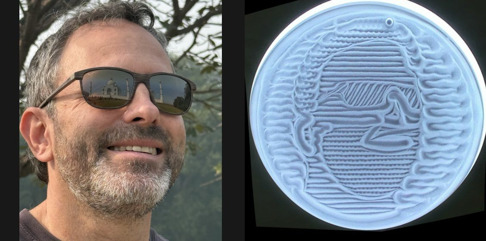

# Portraits

How to turn a photo of a person into a sand drawing. Written for people and for AI assistants;
`designs/portrait.py` does the drawing, and [designs/portraits/sunglasses.json](../designs/portraits/sunglasses.json)
is a worked example (photo, description, and a photo of the result on the table).



Only use photos you have the right to use, and ask the people in them first.

## Draw an illustration, not a copy

A portrait in sand is a creative interpretation. Copying the photo doesn't work:

- **There's no grey.** Sand shows grooves, ridges and flat areas, not shades. A spiral that wiggles more where
  the photo is dark (the plotter-art approach) comes out as an even texture with no face in it.
- **The resolution is low.** The groove is about 0.07 radii wide, so the table holds about 25 grooves across. A
  real eye is a third of a groove.
- **Traced outlines are noise.** Outlining the photo's tones gives the shadows and the background as much weight
  as the face.

What works is what an illustrator does: pick the handful of features that make this person recognisable,
exaggerate them, and give each a sand texture that stands for it.

## The method

1. **Crop.** Choose a circle around the head, in photo pixels. Let the head fill it: the face should be at
   least 0.8 radii wide on the table.
2. **Pick the features.** Usually 5 to 9: the silhouette, hair, eyes or glasses, nose, mouth, and whatever is
   distinctive (a beard, earrings, a collar). Leave out everything else.
3. **Exaggerate small features.** Anything under about 0.1 radii disappears, so eyes are typically drawn 1.5 times
   their size, brows and mouth 1.25 times.
4. **Outline each feature** as a closed shape: a list of points in photo pixels, which are smoothed into a curve.
   `python3 designs/portrait.py --grid PHOTO.jpg GRID.png` writes the photo with a labelled pixel grid; read
   the points off it. An AI assistant can read the grid image and write the outlines directly; that's how
   the example was made.
5. **Choose a texture for each feature** (below), and write the description.
6. **Preview, then draw.** `python3 designs/portrait.py DESCRIPTION.json OUT.txt --preview PREVIEW.png`. Look at
   the preview for stray lines. A portrait fills the whole table, so it doesn't need a clear first; it takes
   15–20 minutes.

## How the drawing hides its moves

The ball never lifts, so every move between features would normally leave a line. The drawing order avoids
that:

1. **Features first.** Each feature is drawn inside its own outline.
2. **Skin.** Rows rake across the face, and wherever a row meets a feature it follows the feature's outline round
   to the far side instead of crossing it. This does two things: it gives every feature a bold edge, and it
   rakes away the moves made in step 1.
3. **Background.** Rows rake across the table and bend round the head the same way, so the silhouette gets a
   bold edge too.
4. **Big textured areas last** (marked `late`): hair, ears, clothes. They border both the skin and the
   background, so a move into them would cross open sand; drawn last, their own rows wipe out those moves.

Every move between pieces travels along a groove that's already drawn, or an outline the drawing traces
anyway (a feature's edge, the silhouette, the rim), so it retraces a groove instead of cutting a new one.
Where no groove connects two pieces, the move follows grooves as far as it can from both ends and makes the
one new line as short as possible; later rows usually rake it away.

## Textures that read

From drawing on the table:

| Texture | Description setting | Reads as |
|---|---|---|
| Straight rows 0.05 apart | `{"spacing": 0.05}` | skin: calm, even |
| Wavy rows 0.06–0.07 apart | `"kind": "wavy", "amp": 0.012, "wave": 0.16` | background, distinct from skin |
| Dense rows 0.025–0.03 apart, at an angle | `{"spacing": 0.03, "angle": 60}` | dark, solid things: sunglasses, a jacket |
| Rows along the flow, slightly wavy | `"angle": 80, "kind": "wavy", "amp": 0.008, "wave": 0.3` | long straight hair |
| Loops | `"kind": "loops", "amp": 0.02, "wave": 0.05` | curly hair |
| Zigzag | `"kind": "zigzag", "amp": 0.016, "wave": 0.04` | stubble, a beard |
| A stroke drawn twice | `{"pts": [...], "passes": 2}` | a single line: nose, smile, the inside of an ear |
| A small closed stroke drawn 3–4 times | `"closed": true, "passes": 4` | a dot: pupils, earrings |
| `outline_passes: 2` | | a feature that needs a heavier edge (glasses frames) |

## The description

```json
{
  "name": "portrait: sunglasses and beard",
  "crop": {"cx": 340, "cy": 480, "radius": 450},
  "head": [[400, 40], [475, 60], ...],
  "face": [[...]],
  "skin": {"spacing": 0.05, "angle": 0},
  "background": {"spacing": 0.07, "kind": "wavy", "amp": 0.012, "wave": 0.16},
  "zones": [
    {"name": "beard", "outline": [[...]], "holes": ["mouth"],
     "fill": [{"spacing": 0.045, "kind": "zigzag", "amp": 0.016, "wave": 0.04}]},
    {"name": "mouth", "within": "beard", "outline": [[...]],
     "strokes": [{"pts": [[...]], "passes": 2}]},
    {"name": "hair", "late": true, "outline": [[...]], "fill": [{"spacing": 0.05, "kind": "loops"}]}
  ]
}
```

| Key | Meaning |
|---|---|
| `crop` | centre and radius of the circle, in photo pixels, that becomes the table |
| `head` | the silhouette: head, hair and neck |
| `face` | optional: where the skin rows go, if not the whole silhouette (long hair framing a face) |
| `skin`, `background` | row style for the face and for the rest of the table |
| `start` | where the ball is when the drawing starts (default: bottom of the rim) |
| `zones` | features, drawn in the order listed |
| `outline` | the feature's closed outline (photo pixels) |
| `fill` | list of row styles: `spacing`, `angle` (degrees), `kind` (`straight`, `wavy`, `zigzag`, `loops`), `amp`, `wave` |
| `strokes` | lines drawn inside the feature: `pts`, `passes`, `closed` |
| `outline_passes` | draw the outline itself this many times |
| `holes` | other zones this one's rows bend round (a mouth inside a beard) |
| `within` | this zone sits inside another; the skin rows ignore it |
| `inside: false` | the zone is outside the silhouette (clothes); the background bends round it |
| `late` | draw after the background (hair, ears, clothes) |

All distances in styles are in table radii.
