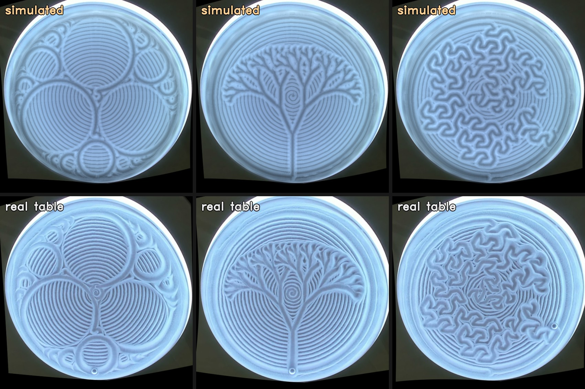

# Sand twin

A physical model of the sand: a heightfield the ball ploughs through, with the displaced sand piling up beside
the groove and slumping to its angle of repose, rendered under the table's ring light. It shows what a drawing
will really look like in the sand, ridges and all, which the lighter preview built into Drifted
([docs/digital-twin.md](../../docs/digital-twin.md)) doesn't.

It was built by drawing on a real 16" table with a webcam over it, and tuning the model until its pictures
matched the photos. Everything learned from that is baked in: **you don't need a camera, a table or any
recordings to use it.**



## Previews

Needs Python 3, numpy and OpenCV (`pip install numpy opencv-python`), and ffmpeg for videos.

```sh
python3 tools/twin/preview.py drawing.json sand.png              # the sand afterwards
python3 tools/twin/preview.py drawing.json drawing.mp4           # time-lapse of the ball drawing it (40x)
python3 tools/twin/preview.py drawing.json drawing.gif --speed 100
python3 tools/twin/preview.py first.json second.json sand.png    # several drawings in order, on the same sand
```

`drawing.json` is a drawing as Drifted takes it: `{"xy": [[x, y], ...]}` in table radii, or
`{"points": [[theta, rho], ...]}`. The examples in [designs/](../../designs) write it directly, for example
`python3 designs/tree.py tree.json`. A still takes a couple of seconds; a time-lapse of a 15-minute drawing
takes about half a minute on a laptop.

The sand starts smooth, so the first drawing in a preview lands on fresh sand. That's fine for drawings that
cover the table or start with a clear; for a small drawing on top of whatever was there before, pass the earlier
drawing first.

## How it was built: a webcam feedback loop

1. **Draw and record.** `record.sh` sends a drawing to the table through Drifted and keeps the path, a photo
   before and after, and a video of the ball.
2. **Line up photo and model.** `photo.py` finds the table's rim in the photo, straightens it to a top-down
   view, and fine-tunes the alignment against the grooves, so each photo pixel matches a point on the model's
   grid.
3. **Score the prediction.** The model replays every drawing in order (the sand remembers earlier drawings),
   renders the result, and compares it with the photo: how much of the photo's fine light-and-shadow detail the
   render explains (R²).
4. **Change the model, refit, repeat.** `evaluate.py --fit` tunes the sand parameters on some runs and scores
   on runs it hasn't seen. `track.py` finds the ball in the video to check where it really went. Test drawings
   (`testcard.py`, `sampler.py`) isolate one behaviour each: tight turns, crossings, dense rows.

What the loop found, now in the defaults (`Params` in `sand.py`):

- The ball is about 0.034 table radii in radius and sits half buried. The cut sand lands just beside the
  groove, mostly on the side it was cut from, and settles at about 39°.
- The ball follows the commanded path to within about 0.012 radii at 0.10–0.12 radii per second; sand
  rounding at tight turns looks like a lag of about 0.02 radii.
- Cast shadows from the ring light matter as much as the grooves themselves.
- The look (lighting mix and the table's colour, in `look/`) was fitted to one photo and holds for all of them.

What didn't help: a finer grid, carrying sand in a bow wave, driving the model from the tracked ball path,
letting the ball ride the surface, packed sand holding a steeper slope.

## How close it is

Scored against photos of real drawings it hadn't been tuned on:

| Drawings | R² |
|---|---|
| Clock face and 24 five-minute updates | 0.80–0.88 |
| Seven everyday drawings (weather, text, a birthday card…) | 0.58–0.82, mean 0.65 |
| Fractals: Apollonian gasket, tree, flowsnake | 0.49–0.57 |

Two photos of the same sand agree at 0.95–0.99, so the gap is the model. Where it falls short: real sand keeps
dense parallel rows (0.035–0.04 radii apart) crisp where the model washes them out, and real ridges are sharper,
so the old positions of a moving line (like a clock hand) leave stronger ghosts on the table than in the model.
Ball and alignment noise of about 0.01 radii puts a realistic ceiling around 0.75–0.8.

## The files

| File | What it does | Needs |
|---|---|---|
| `preview.py` | stills and time-lapses of any drawing | nothing |
| `sand.py` | the sand model and renderer | nothing |
| `video.py` | time-lapses, side-by-side compositions, clock variants | nothing (the look is in `look/`) |
| `clockhub.py`, `testcard.py`, `sampler.py` | test drawings: clock variants, the calibration card, a texture sampler | nothing |
| `record.sh` | draw on the table and record it | a table, Drifted, a webcam |
| `photo.py`, `compare.py`, `card_report.py` | line up photos with the model and score them | photos |
| `evaluate.py`, `fit.py` | score and refit the model over recorded runs | recorded runs |
| `track.py`, `ballpath.py` | find the ball in the video, compare with the path sent | recorded runs |
| `sidebyside.py` | real table and model side by side, in step | recorded runs |

To calibrate against your own table: record a few drawings with `record.sh` (runs go to
`~/Library/Application Support/Drifted/runs`), fit with `evaluate.py --fit`, and refit the look with
`video.calibrate(recalibrate=True)`, which saves your own `twin-look.npz` and is then used instead of `look/`.
